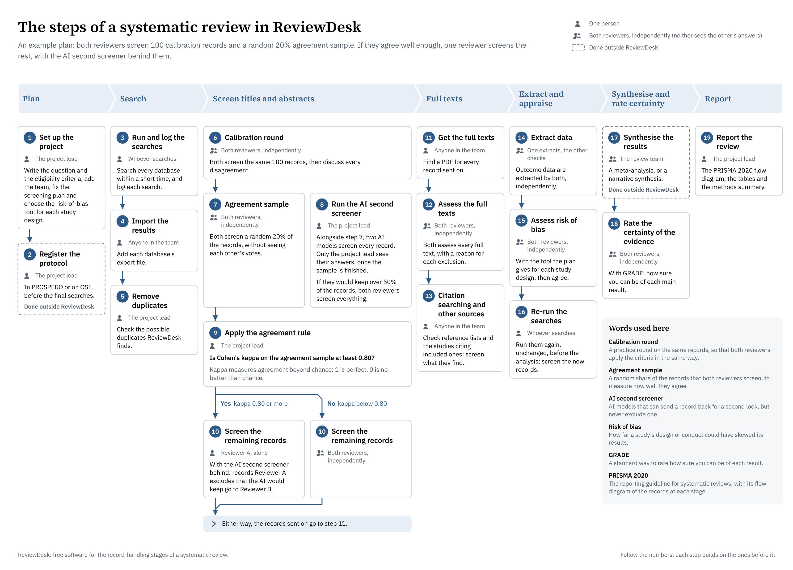
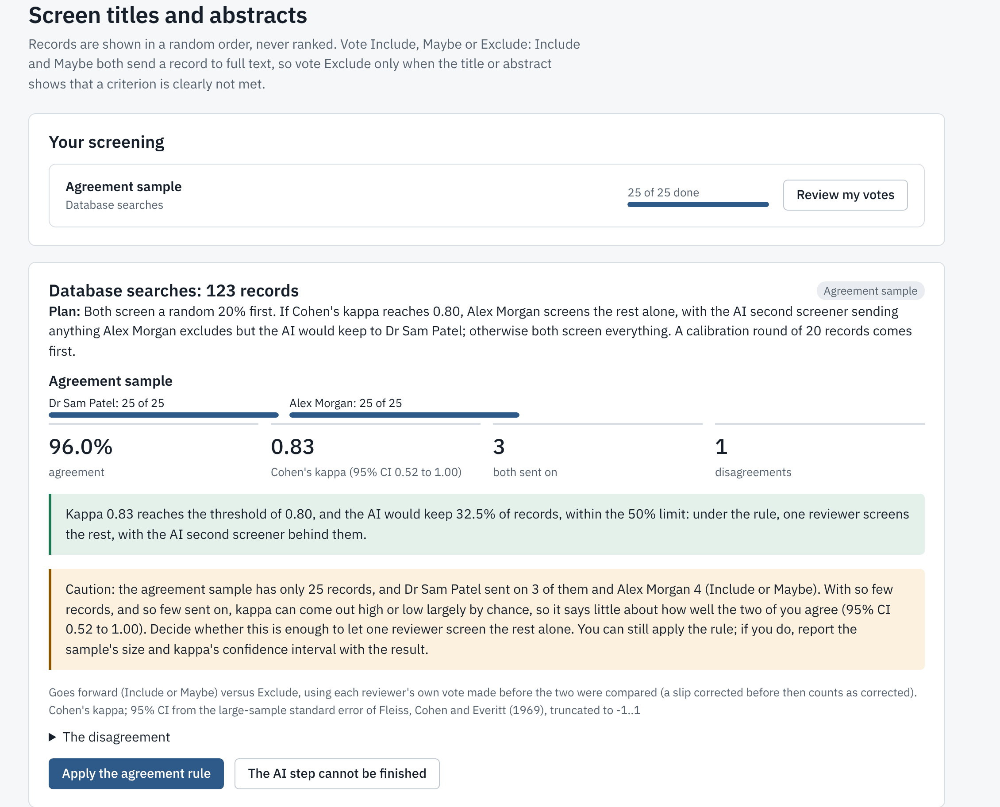

# ReviewDesk

[](https://www.bestpractices.dev/projects/17036)

ReviewDesk is free software for running the record-handling stages of a systematic review as a team: logging the
searches, importing database exports, removing duplicates, screening titles and abstracts, reviewing full texts,
extracting data, assessing risk of bias, rating the certainty of the evidence with GRADE, and producing the PRISMA 2020
flow diagram and a reporting pack with the tables, methods text and appendix files the write-up needs. An optional AI
second screener can stand behind single-reviewer screening; it never excludes a record.



## How it works

- **It runs on each reviewer's own computer** and opens in the web browser. On Windows nothing needs installing.
- **The team shares an ordinary folder**, such as a Microsoft Team or SharePoint site, OneDrive, Dropbox or
  Google Drive. There is no server, no account to create and no subscription, and the review data stay in your
  own organisation's storage.
- **Each file has one writer wherever it matters**, so the sync service almost never has two people editing the same
  file. Each person's votes, judgements, search log and audit log go in files of their own, and the files the whole
  team relies on (the settings, the records, the screening state) are written only by the project lead. The search
  worksheet is shared on purpose: anyone in the team may save it, and ReviewDesk checks that nobody else saved it in
  the meantime. Anyone may add an imported file or a PDF.
- **Accidents are noticed.** Every decision is time-stamped and stored in the file of the person who made it. Each row
  carries a fingerprint linked to the row before it, and each computer keeps its own copy of every project file it
  has seen, so a row changed or lost through a sync fault, an older copy put back or an edit in another program is
  reported under **Data problems** on any computer that had seen it, and can be put back. These checks are for
  accidents and sync faults, not against a team member who sets out to change the files: see
  [SECURITY.md](SECURITY.md).

## What it supports

- **A guided set-up**: the project lead is taken through the set-up one topic at a time (the review, protocol
  registration and planned dates, the team, the eligibility criteria, the screening plan, full texts, extraction and
  the risk-of-bias plan, the AI second screener, the searches), with what each choice means and an example, and a
  set-up summary to check against the protocol. Or every setting on one page.
- **"What is missing" checks**: before each step, the Overview and the step's own page say what that step still needs
  (Needed) or what is worth a look (Check), why it matters, and where to put it right.
- **The steps, in order**: a timeline of every step of your review, with who does each, your planned dates and where
  the review is, to download as a picture or print.
- A search worksheet and search log in the form PRISMA-S asks for.
- Import of RIS, PubMed (.nbib), Cochrane, Web of Science and CSV exports, with logged, rule-based de-duplication.
- Title and abstract screening in a recorded random order: a calibration round; an agreement sample with Cohen's
  kappa and its 95% confidence interval; and a pre-specified rule for whether one reviewer may screen the rest.
- An AI second screener using an OpenAI-compatible service that you choose. Records it would keep that the single
  reviewer excluded go to a second reviewer; its accuracy on the agreement sample is reported but decides nothing.
- **A verification sample**, for a review in which one reviewer screens most records alone: a second person screens,
  blind, a random sample of the records that left on that one vote, and anything they would send on goes to full
  text. The lead sees the share with its confidence interval, so the methods can say how much single screening lost.
- **Time recording and evaluation data**, both off unless the project lead switches them on, for a team that wants to
  measure how its screening went: how long each vote took (everyone is told, and can leave their own votes out), and
  one download with every record, vote and AI answer for an analysis of accuracy and time.
- Dual full-text review with reasons for exclusion, and decisions for studies awaiting classification, ongoing
  studies and reports not retrieved; help finding open-access PDFs; data extraction by one reviewer, checked by a
  second, with the outcome data extracted by both.
- **A risk-of-bias plan**, recorded in set-up before screening starts, as the protocol sets it: for each study design
  the review includes, the tool used (or no assessment, with the reason). Once screening has started only the project
  lead can change it, with a reason, and each change is reported as a protocol amendment. Reviewers choose a study's
  design when they add an assessment, and the tool follows.
- **Built-in risk-of-bias tools**, each checked against its published source: RoB 2 (individually randomised
  parallel-group trials, cluster-randomised trials and crossover trials), ROBINS-I V2, ROBINS-I 2016 (also for
  uncontrolled before-after studies and interrupted time series), ROBINS-E, QUADAS-2 (with applicability),
  PROBAST+AI and QUIPS. Two reviewers judge each domain independently on the tool's own scale; the overall judgement
  must follow the tool's own rule, and the lead agrees any differences.
- **Tools the lead defines**, for checklists such as JBI, CASP, the Newcastle-Ottawa Scale, MMAT, AMSTAR 2 and
  ROBIS: the lead types the tool's name, version and citation, the labels of its items and its answer scale.
  ReviewDesk ships none of those tools' wording; reviewers use the official tool alongside.
- **GRADE**: the lead defines each main outcome, two reviewers rate the certainty of its evidence independently, the
  lead agrees any differences, and ReviewDesk makes the evidence profile and the summary of findings. Test accuracy
  outcomes follow GRADE for test accuracy: the lead gives the target condition, the pre-test probabilities and the
  sensitivity and specificity, and the summary of findings shows true and false results per 1,000 people tested.
- **The reporting pack**: one .zip with the PRISMA 2020 flow diagram; tables of the studies excluded at full text
  (with reasons), included, awaiting classification, ongoing and not retrieved; the characteristics of included
  studies; the risk-of-bias plan, tables and figure; the summary of findings and evidence profile (GRADE); the
  methods text; the screening agreement report; the AI second screener report and prompts; the PRISMA 2020
  checklist filled in where ReviewDesk can; the PRISMA-S search appendix and search log; the PRISMA counts; the
  de-duplication, records, decisions, AI answers and audit logs; and a data checks report. A "Read me first" file says which PRISMA 2020 or PRISMA-S item each one
  answers.



## Download and start

Download the latest version from the [Releases](../../releases) page. Use the two zips named below, not "Source
code", which is for developers.

| System | Download | To start |
|---|---|---|
| Windows | `ReviewDesk-x.y.z-windows.zip` (Python 3.14 included) | Right-click the zip and choose **Extract All**, then **Extract**. In the folder it makes, open the `ReviewDesk-x.y.z` folder and double-click **Start ReviewDesk.bat** |
| Mac | `ReviewDesk-x.y.z.zip` | Install Python 3.9 or later from [python.org](https://www.python.org/downloads/macos/), then double-click **Start ReviewDesk (Mac).command** |
| Linux | `ReviewDesk-x.y.z.zip` | `sh start-reviewdesk.sh` (Python 3.9 or later) |

- **Windows:** if Windows shows "Windows protected your PC", choose **More info** and then **Run anyway**.
- **Mac:** after installing Python, open the Python folder in Applications and double-click
  **Install Certificates.command** once; without it, the AI screener and the PDF finder cannot connect. If the Mac
  says the start file cannot be opened, go to **System Settings > Privacy & Security** and choose **Open Anyway**. If
  the Mac asks whether Terminal may reach files in your Documents, Downloads or Desktop folder, or in OneDrive, choose
  **Allow**: without it ReviewDesk cannot open a project there (you can change this later in **System Settings >
  Privacy & Security > Files and Folders**).
- **Checking a download (optional):** the [release notes](../../releases/latest) give each zip's SHA-256 checksum and
  the one command that shows it on Windows, Mac and Linux; the two should be exactly the same.

Read the user guide ([PDF](docs/ReviewDesk%20user%20guide.pdf), [Word](docs/ReviewDesk%20user%20guide.docx)) before
starting a review. If you are setting up a review for the first time, the set-up walk-through
([PDF](docs/ReviewDesk%20set-up%20walk-through.pdf), [Word](docs/ReviewDesk%20set-up%20walk-through.docx)) takes the
project lead through it step by step. Both are also in each download.

## Upgrading from an earlier version

Extract the new version to a **new folder** (do not copy it over the old one), and close the old ReviewDesk window
before you start the new one. Your settings, your AI key and your projects are kept. **Everyone in a team moves to
the new version on the same day, the project lead first, and nobody goes back to the old one**: an older version
cannot read some things the new one records, such as an "Ongoing study" decision or the newer risk-of-bias tools,
and shows "Something went wrong". ReviewDesk warns when someone in the team last used an older version, and from
version 1.3 an older ReviewDesk refuses to open a project that needs a newer one, or stops saving in it, and says
which version to download. The move from 1.3.0 to 1.3.1 is one of these: 1.3.0 cannot check the whole fingerprints
that 1.3.1 keeps. After upgrading a project begun with an earlier version, the project lead records the
risk-of-bias plan when ReviewDesk asks. Then delete the old folder. [UPGRADING.md](UPGRADING.md) gives the steps in
full.

## Sharing a project

Create the project in a folder the whole team can reach. The best place is a Microsoft Team or SharePoint site with
at least two owners: a folder in one person's OneDrive is deleted when they leave their organisation. Set the
project folder to **Always keep on this device**; ReviewDesk warns if any project files are stored online only.

## What is sent where

ReviewDesk runs on your own computer and sends something elsewhere only when you use these features:

- **The AI second screener** sends the review question, the eligibility criteria (as the prompt) and each record's
  title, abstract, year, journal and publication type to the AI service the project lead sets up under
  **My settings**. There is no default service: choose one your organisation allows, and check where it processes
  the data. With the University of Edinburgh's ELM, ReviewDesk uses only ELM's University-hosted models.
- **The open-access PDF finder** sends a report's DOI, PubMed ID or title to Unpaywall, Europe PMC, OpenAlex and
  Semantic Scholar (your email address to Unpaywall and OpenAlex, which ask for one), then downloads PDFs from the
  publisher or repository addresses they return.

The AI service's API key is kept in your personal settings on your computer (encrypted for your Windows account on
Windows), never in the shared project folder, and is only ever sent to the address it was saved with (unless a
developer gives another address in the environment: see SECURITY.md). The project
folder holds the records, the reviewers' names, initials and decisions (with how long each vote took, while the
project lead has time recording switched on), and an audit log that includes each computer's network name. Each computer also keeps its own copies of project files and PDFs for the data checks (on
Windows in `%LOCALAPPDATA%\ReviewDesk`, which is not copied to an organisation's profile servers); delete a
project's folder there once the review is archived. Report the AI's role in your methods. See
[SECURITY.md](SECURITY.md) for how ReviewDesk protects the data on your computer.

## Citing ReviewDesk

If you use ReviewDesk, please cite it. GitHub's **Cite this repository** button gives the reference, from
[CITATION.cff](CITATION.cff).

## Status and support

ReviewDesk is designed, directed and looked after by one person, Chris Humphries, in his own time. Its code is
written with Claude, an AI model made by Anthropic, working to his direction. Before a release it must pass the
automated tests on Windows, Mac and Linux, and changes to how a review's data is kept are reviewed by separate
instances of Claude that did not write them ([CONTRIBUTING.md](CONTRIBUTING.md) describes both). Version 1.3 is the
first public release. Check what it produces as you would with any tool, and keep your own backup of the project
folder.

- A question or a problem: open an issue (see [CONTRIBUTING.md](CONTRIBUTING.md)). Please never attach a real
  review's records, decisions or project folder.
- A security problem: see [SECURITY.md](SECURITY.md).
- There is no promised reply time. Anything that could lose work or give a wrong result comes first.

## For developers

ReviewDesk uses only the Python standard library (3.9 or later) and plain JavaScript; there is nothing to install
to run it. The start files in `launchers/` also work from a clone or a "Download ZIP" of this repository, with a
Python 3.9 or later installed on the computer. Or, from the top folder (on Windows type `python` or `py` where these
lines say `python3`):

```
python3 app/run_reviewdesk.py                            # start it from the source
python3 app/run_reviewdesk.py --no-browser --port 8123   # without opening the browser, on another port
python3 tools/build_release.py                           # build the download zips into dist/
```

[CONTRIBUTING.md](CONTRIBUTING.md) says how to run the tests and the static analysis, both of which GitHub runs on
every push. The tests never use a real AI service or key: the AI second screener is tested against a local stand-in.
`python3 tools/make_guide_screenshots.py` remakes the screenshots in the guides (docs/images/guide) from an invented
demonstration review, and `python3 tools/make_timeline_image.py` the timeline pictures.
[docs/dev/DESIGN.md](docs/dev/DESIGN.md) says how ReviewDesk is built, and
[docs/dev/RELEASING.md](docs/dev/RELEASING.md) how a version is published. Contributions are welcome; see
[CONTRIBUTING.md](CONTRIBUTING.md).

## Licence

ReviewDesk is released under the [MIT License](LICENSE). Copyright (c) 2026 Chris Humphries. It includes
third-party software and fonts under their own licences; see [NOTICE.txt](NOTICE.txt).
